# Contextless Web Markup Translation

Dataset and translation experiments for **“Overcoming contextless web markup text translation: A parallel and selective Q&A-driven LLM approach.”** The dataset contains **1,018 translation items and 174 language-specific HTML snapshots**. [한국어](README.md) [Dataset structure](DATASET.en.md)

The method cleans HTML and translates selected strings using their surrounding markup as context. Experiments support different models, context sizes, cleansing settings, and parallel translation of selected page nodes.

## Translation examples

These **five examples** use actual local inference with the same `Qwen2.5-Coder-32B-Instruct` model. Both conditions use temperature 0.01, a 32-token generation limit, and seed 0.

- **contextless**: `--mode contextless` receives only the source string.
- **contextful**: `--mode qa --window 128` receives cleansed HTML with 128 context characters per side.

| Before translation | After translation (contextless) | After translation (contextful) |
|---|---|---|
| dismiss | 거부하다 | 닫기 |
| Stoffart | 질감 | 소재 |
| Herkunft | 태생 | 원산지 |
| Devoluciones | 환불 | 반품 |
| Enviar a | 전송하기 | 보내기 |

For `Enviar a`, the contextful condition still produced `보내기` instead of the manual reference `배송`. Item IDs, references, and conditions are in the [comparison data](examples/comparison_5.json). Actual inputs and responses are in the [contextless results](validation/local_model_32b_contextless5.jsonl) and [contextful results](validation/local_model_32b_10.jsonl). Each condition uses the prompt format of its stated mode.

### Webpage screenshots

**All five examples have screenshots for all three conditions.** The archived HTML and local resources are rendered in a browser, and only the current target is replaced with its recorded translation. Other page text remains unchanged. Orange marks the source, blue marks contextless, and green marks contextful. Click an image to enlarge it.

#### 1. Dismiss button in the delivery notice: `dismiss` (`en2ko:2`)

| Before translation | After translation (contextless) | After translation (contextful) |
|---|---|---|
| [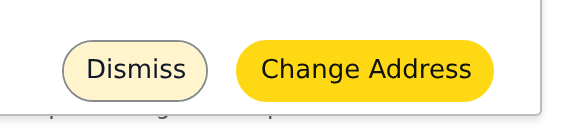](examples/screenshots/en2ko_2_before.png) | [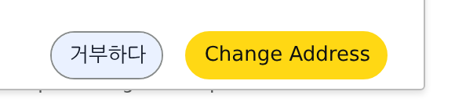](examples/screenshots/en2ko_2_contextless.png) | [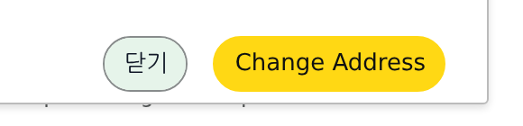](examples/screenshots/en2ko_2_contextful.png) |

[Archived page overview](examples/screenshots/overview_en_0.png)

#### 2. Fabric field in product information: `Stoffart` (`de2ko:1`)

| Before translation | After translation (contextless) | After translation (contextful) |
|---|---|---|
| [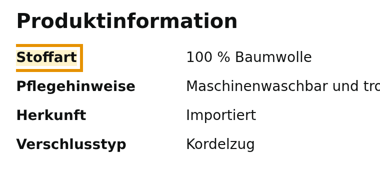](examples/screenshots/de2ko_1_before.png) | [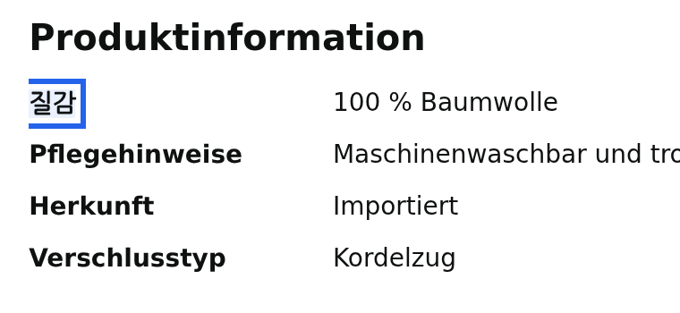](examples/screenshots/de2ko_1_contextless.png) | [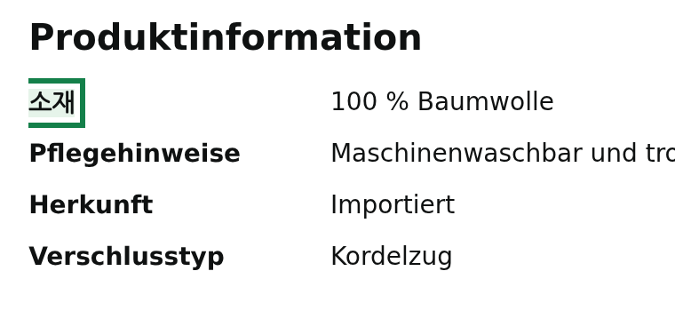](examples/screenshots/de2ko_1_contextful.png) |

[Archived page overview](examples/screenshots/overview_de_0.png)

#### 3. Origin field in product information: `Herkunft` (`de2ko:2`)

| Before translation | After translation (contextless) | After translation (contextful) |
|---|---|---|
| [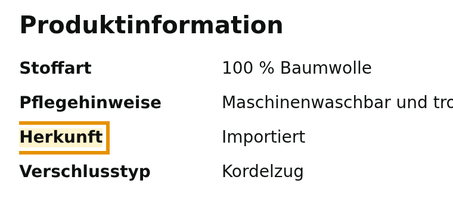](examples/screenshots/de2ko_2_before.png) | [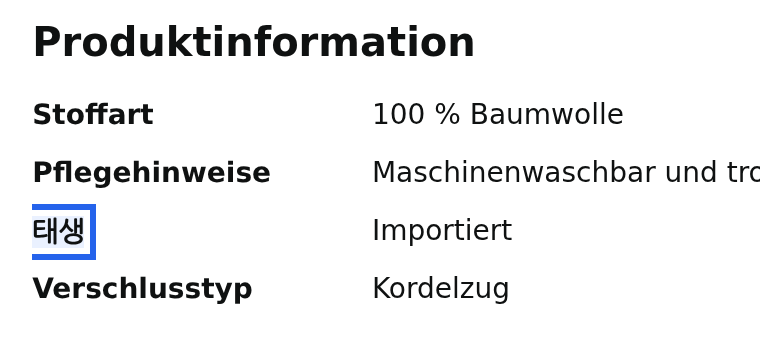](examples/screenshots/de2ko_2_contextless.png) | [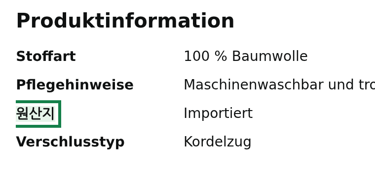](examples/screenshots/de2ko_2_contextful.png) |

[Archived page overview](examples/screenshots/overview_de_0.png)

#### 4. Returns and orders menu: `Devoluciones` (`es2ko:2`)

| Before translation | After translation (contextless) | After translation (contextful) |
|---|---|---|
| [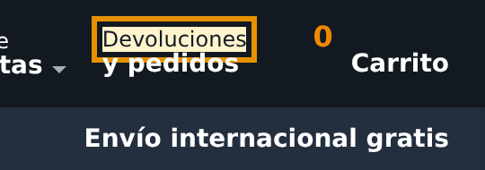](examples/screenshots/es2ko_2_before.png) | [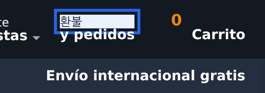](examples/screenshots/es2ko_2_contextless.png) | [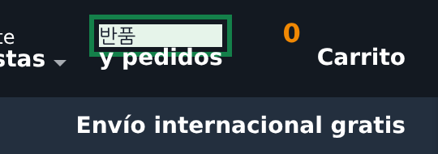](examples/screenshots/es2ko_2_contextful.png) |

[Archived page overview](examples/screenshots/overview_es_0.png)

#### 5. Delivery destination menu: `Enviar a` (`es2ko:1`)

| Before translation | After translation (contextless) | After translation (contextful) |
|---|---|---|
| [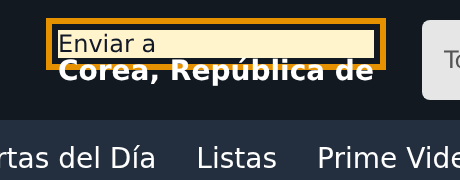](examples/screenshots/es2ko_1_before.png) | [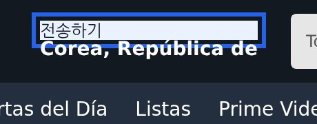](examples/screenshots/es2ko_1_contextless.png) | [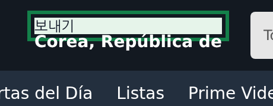](examples/screenshots/es2ko_1_contextful.png) |

[Archived page overview](examples/screenshots/overview_es_0.png)

[Page sources, target positions, and rendering metadata](examples/screenshots.json)

## Installation

Requires Python 3.10+. Run all commands from the extracted `reproduction_bundle/` directory or the root of your Git checkout.

```bash
python -m venv .venv
source .venv/bin/activate
python -m pip install -r requirements.txt
python validate.py
```

On Windows PowerShell, activate the environment with `.venv\Scripts\Activate.ps1`.

The [complete dataset and code ZIP](https://github.com/byunggilljoe/contextless-web-translation/releases/latest) includes all 174 HTML snapshots. For a Git checkout, copy `reproduction_bundle/data/html/` from the ZIP to `data/html/` in your checkout before running validation.

Inspect translation prompts and cleansed HTML:

```bash
python run.py translate --pair en2ko --limit 2 --dry-run --output outputs/prompts.jsonl
python run.py clean --input data/html/en/0/original.html --output outputs/cleaned.html
```

`--dry-run` saves prompts without calling a model.

## Model selection

### Local GPU

Use a vLLM-supported model with a tokenizer chat template. Install a vLLM version compatible with your GPU/CUDA environment.

```bash
python -m pip install -r requirements-vllm.txt
python run.py translate --backend vllm --model Qwen/Qwen2.5-Coder-7B-Instruct \
  --pair en2ko --limit 2 --window 128 --output outputs/local_qa.jsonl
```

Change `--model` to another model ID or a downloaded directory such as `/path/to/local-model`. GPU settings include `--tensor-parallel-size`, `--max-model-len`, and `--gpu-memory-utilization`.

### Local or lab server

Specify the address and model ID of a running Chat Completions compatible server:

```bash
export OPENAI_API_KEY=EMPTY
python run.py translate --backend api --base-url http://127.0.0.1:8000/v1 \
  --model Qwen/Qwen2.5-Coder-7B-Instruct --pair en2ko --limit 2 \
  --window 128 --workers 4 --output outputs/server_qa.jsonl
```

Replace `EMPTY` with the server's key if authentication is enabled.

### Commercial remote API

Replace the URL, key, and model ID with values supplied by the service:

```bash
export OPENAI_API_KEY=YOUR_API_KEY
python run.py translate --backend api --base-url https://YOUR_API_HOST/v1 \
  --model REMOTE_MODEL_ID --pair en2ko --limit 2 --window 128 \
  --output outputs/remote_qa.jsonl
```

`OPENAI_BASE_URL` can be used instead of `--base-url`; the command-line option takes precedence. The runner appends `/chat/completions`. Set environment variables in the shell; `.env` files are not loaded automatically.

The API must accept Bearer authentication and the fields `model`, `messages`, `temperature`, and `max_tokens`. Other authentication schemes or request fields require an API adapter change.

Start with `--limit 2`, inspect results, then omit the limit for the full experiment.

## Experiment settings

| Option | Meaning | Default |
|---|---|---|
| `--pair` | `en2ko`, `de2ko`, `es2ko`, `zh2ko`, or `all` | `all` |
| `--window` | Context characters per side of the target tag | `128` |
| `--mode` | `qa` with HTML context, or `contextless` with the target text only | `qa` |
| `--no-clean` | Disable HTML cleansing | Cleansing enabled |
| `--sample-ids` | Select IDs such as `en2ko:1 en2ko:2` | All |
| `--temperature` | Generation temperature | `0.01` |
| `--max-tokens` | Maximum generated tokens | `32` |
| `--workers` | Concurrent API requests | `4` |
| `--batch-size` | Requests per batch | `32` |

Compare the zero-window and bare-text conditions using the API key configured above:

```bash
# Keep target tags and instructions; remove surrounding context.
python run.py translate --model REMOTE_MODEL_ID --pair en2ko --window 0 \
  --base-url https://YOUR_API_HOST/v1 --output outputs/window0.jsonl

# Provide the target string without HTML.
python run.py translate --model REMOTE_MODEL_ID --pair en2ko --mode contextless \
  --base-url https://YOUR_API_HOST/v1 --output outputs/contextless.jsonl
```

Direct vLLM enables prefix caching; disable it with `--no-prefix-cache`. API caching is controlled by the server.

## Evaluation

Translations are judged on a 1–5 scale. Translation and judge models can be selected independently.

```bash
python run.py score --backend api --base-url https://YOUR_API_HOST/v1 \
  --model JUDGE_MODEL_ID --pair en2ko --limit 2 \
  --predictions outputs/local_qa.jsonl --output outputs/qa_scores.jsonl

# Evaluate the collected Chrome translations.
python run.py score --backend api --base-url https://YOUR_API_HOST/v1 \
  --model JUDGE_MODEL_ID --pair en2ko --limit 2 \
  --candidate chrome --output outputs/chrome_scores.jsonl
```

`--candidate reference` evaluates manual translations. Evaluation uses a ±512-character cleansed HTML context. Summaries include the mean valid score, coverage, and a mean treating missing/failed entries as 1. Use `--dry-run` to inspect judge prompts.

## Selective page translation

Inspect node IDs and prompts, then select the IDs to translate:

```bash
python translate_page.py --input data/html/en/0/original.html \
  --output outputs/page_preview.html --dry-run

python translate_page.py --input data/html/en/0/original.html \
  --output outputs/page_ko.html --ids 0 3 --block-size 32 \
  --backend api --base-url https://YOUR_API_HOST/v1 --model REMOTE_MODEL_ID
```

Omit `--ids` to translate all target nodes. `--block-size` controls how many nodes share a context prefix. Translations replace text nodes in the original DOM. Selected-node prompts and results are saved in `output.html.nodes.jsonl`. Use `--backend vllm` for direct local GPU execution.

## Outputs and dataset checks

Output paths are relative to the current directory. Existing files are never overwritten. JSONL files contain prompts, responses, translations, statuses, and token usage; `.meta.json` records settings, package versions, and summary statistics.

`truncated` indicates the generation token limit was reached; rerun with a larger `--max-tokens`. `preprocessing_error`, `backend_error`, and `parse_error` identify target-matching, model-call, and response-parsing failures. Runs containing failures save their results and exit with code 1.

The dataset has eight unmatched targets and one empty primary manual reference. See [DATASET.en.md](DATASET.en.md) for IDs and schema.

```bash
python validate.py --check-targets
```

Validation used Python 3.12, Beautiful Soup 4.12.3, and soupsieve 2.6. Data checks and mock API tests passed. **Qwen2.5-Coder-7B-Instruct and 32B-Instruct on an A100 each completed live inference for the same 10 items across all four source languages; every response parsed successfully.** Some translations contain contextual errors. [7B/32B comparison](validation/LOCAL_MODEL_32B.en.md)

The tested GPU package versions are pinned in `requirements-vllm.txt`. Commercial API inference and the paper's complete quality/timing tables remain unverified. [Validation details](VALIDATION.en.md)

[Code overview](PROJECT_OVERVIEW.en.md)
