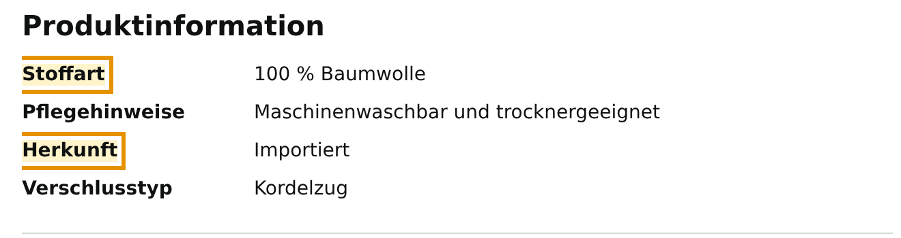
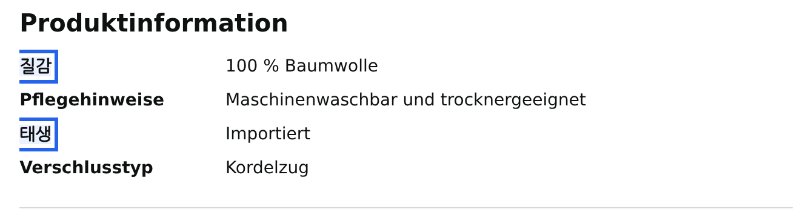
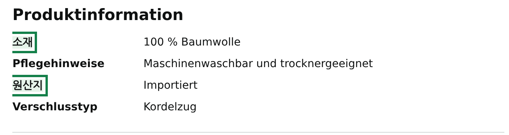

# Contextless Web Markup Translation

논문 **“Overcoming contextless web markup text translation: A parallel and selective Q&A-driven LLM approach”**의 데이터셋과 번역 실험 코드입니다. **번역 항목 1,018개와 언어별 HTML 스냅샷 174개**를 제공합니다. [English](README.en.md) [데이터셋 구조](DATASET.md)

HTML을 정제한 뒤 번역 대상과 주변 문맥을 모델에 전달하여 한국어로 번역합니다. 문맥 크기·정제 유무·모델을 바꿔 비교하거나, 페이지의 선택한 텍스트 노드만 병렬 번역할 수 있습니다.

## 번역 예시

같은 `Qwen2.5-Coder-32B-Instruct`를 로컬에서 실행한 **5개 예시**입니다. 두 조건의 생성 설정은 temperature 0.01, 최대 32토큰, seed 0입니다.

- **contextless**: `--mode contextless`로 원문 문자열만 입력합니다.
- **contextful**: `--mode qa --window 128`로 정제 HTML의 주변 문맥을 좌우 128문자씩 제공합니다.

| 번역 전 | 번역 후 (contextless) | 번역 후 (contextful) |
|---|---|---|
| dismiss | 거부하다 | 닫기 |
| Stoffart | 질감 | 소재 |
| Herkunft | 태생 | 원산지 |
| Devoluciones | 환불 | 반품 |
| Enviar a | 전송하기 | 보내기 |

`Enviar a`는 contextful에서도 참조 번역인 `배송` 대신 `보내기`를 생성했습니다. 항목 ID·참조 번역·조건은 [비교 데이터](examples/comparison_5.json), 실제 입력과 응답은 [contextless 결과](validation/local_model_32b_contextless5.jsonl)와 [contextful 결과](validation/local_model_32b_10.jsonl)에 있습니다. 각 조건은 위 모드의 프롬프트 형식을 사용합니다.

### 웹페이지에서의 비교

수집한 독일어 상품 페이지(`de/0`)에 두 조건의 실제 번역을 각각 적용한 화면입니다. `Stoffart`와 `Herkunft` 두 항목만 변경했으며, 나머지 본문은 독일어로 유지됩니다. 원문은 주황색, contextless는 파란색, contextful은 초록색으로 표시했습니다.

| 번역 전 | 번역 후 (contextless) | 번역 후 (contextful) |
|---|---|---|
|  |  |  |

[상품 페이지: 번역 전](examples/product_before.png) · [contextless](examples/product_contextless.png) · [contextful](examples/product_contextful.png) · [출처·렌더링 정보](examples/screenshots.json)

## 설치

Python 3.10 이상이 필요합니다. 모든 명령은 ZIP의 `reproduction_bundle/` 또는 Git으로 복제한 프로젝트의 최상위 폴더에서 실행합니다.

```bash
python -m venv .venv
source .venv/bin/activate
python -m pip install -r requirements.txt
python validate.py
```

Windows PowerShell에서는 `.venv\Scripts\Activate.ps1`로 가상환경을 활성화합니다.

[전체 데이터·코드 ZIP](https://github.com/byunggilljoe/contextless-web-translation/releases/latest)에는 HTML 174개가 포함되어 있습니다. Git으로 받은 경우에는 ZIP의 `reproduction_bundle/data/html/`을 복제한 프로젝트의 `data/html/`로 복사한 뒤 검증합니다.

입력 프롬프트와 HTML 정제 결과는 다음 명령으로 확인합니다.

```bash
python run.py translate --pair en2ko --limit 2 --dry-run --output outputs/prompts.jsonl
python run.py clean --input data/html/en/0/original.html --output outputs/cleaned.html
```

`--dry-run`은 프롬프트를 저장하며 모델을 호출하지 않습니다.

## 모델 선택 및 실행

### 로컬 GPU

vLLM이 지원하고 tokenizer에 chat template이 있는 모델을 사용합니다. GPU/CUDA 환경에 맞는 vLLM을 설치합니다.

```bash
python -m pip install -r requirements-vllm.txt
python run.py translate --backend vllm --model Qwen/Qwen2.5-Coder-7B-Instruct \
  --pair en2ko --limit 2 --window 128 --output outputs/local_qa.jsonl
```

`--model`에 다른 모델 ID 또는 `/path/to/local-model`처럼 다운로드한 모델 디렉터리를 지정하면 모델을 교체할 수 있습니다. 여러 GPU는 `--tensor-parallel-size`, 입력 길이는 `--max-model-len`, GPU 메모리 사용 비율은 `--gpu-memory-utilization`로 설정합니다.

### 로컬·연구실 모델 서버

실행 중인 Chat Completions 호환 서버의 주소와 모델명을 지정합니다.

```bash
export OPENAI_API_KEY=EMPTY
python run.py translate --backend api --base-url http://127.0.0.1:8000/v1 \
  --model Qwen/Qwen2.5-Coder-7B-Instruct --pair en2ko --limit 2 \
  --window 128 --workers 4 --output outputs/server_qa.jsonl
```

서버에 인증이 설정되어 있으면 `EMPTY`를 서버의 키로 바꿉니다.

### 원격 상용 API

서비스가 제공하는 주소·키·모델명으로 바꿉니다.

```bash
export OPENAI_API_KEY=YOUR_API_KEY
python run.py translate --backend api --base-url https://YOUR_API_HOST/v1 \
  --model REMOTE_MODEL_ID --pair en2ko --limit 2 --window 128 \
  --output outputs/remote_qa.jsonl
```

`--base-url` 대신 `OPENAI_BASE_URL` 환경변수를 설정해도 됩니다. 두 값을 모두 지정하면 옵션이 우선합니다. 주소 뒤에 `/chat/completions`가 자동으로 붙습니다. 환경변수는 셸에서 설정하며 `.env`는 자동으로 읽지 않습니다.

API는 Bearer 인증과 `model`, `messages`, `temperature`, `max_tokens` 필드를 지원해야 합니다. 다른 인증 방식이나 요청 필드가 필요한 모델에는 API 어댑터 수정이 필요합니다.

먼저 `--limit 2`로 결과를 확인하고, 전체 실험에서는 `--limit`을 생략합니다.

## 실험 설정

| 옵션 | 의미 | 기본값 |
|---|---|---|
| `--pair` | `en2ko`, `de2ko`, `es2ko`, `zh2ko`, `all` | `all` |
| `--window` | 대상 태그 좌우에 제공할 문자 수 | `128` |
| `--mode` | HTML 문맥을 쓰는 `qa` 또는 대상 문자열만 쓰는 `contextless` | `qa` |
| `--no-clean` | HTML 정제 생략 | 정제 사용 |
| `--sample-ids` | `en2ko:1 en2ko:2`처럼 항목 ID로 선택 | 전체 |
| `--temperature` | 생성 temperature | `0.01` |
| `--max-tokens` | 최대 생성 토큰 수 | `32` |
| `--workers` | API 동시 요청 수 | `4` |
| `--batch-size` | 배치에 포함할 요청 수 | `32` |

문맥 크기 0과 무문맥 조건은 다음과 같이 비교합니다. 위에서 설정한 API 주소·키를 사용합니다.

```bash
# 태그와 번역 지시를 유지하고 주변 문맥만 제거
python run.py translate --model REMOTE_MODEL_ID --pair en2ko --window 0 \
  --base-url https://YOUR_API_HOST/v1 --output outputs/window0.jsonl

# HTML 없이 대상 문자열만 제공
python run.py translate --model REMOTE_MODEL_ID --pair en2ko --mode contextless \
  --base-url https://YOUR_API_HOST/v1 --output outputs/contextless.jsonl
```

직접 vLLM 실행은 prefix caching을 사용하며 `--no-prefix-cache`로 끌 수 있습니다. API의 캐시 사용 여부는 서버 설정에 따릅니다.

## 번역 평가

번역 결과를 1–5점 기준으로 채점합니다. 번역 모델과 평가 모델은 각각 지정할 수 있습니다.

```bash
python run.py score --backend api --base-url https://YOUR_API_HOST/v1 \
  --model JUDGE_MODEL_ID --pair en2ko --limit 2 \
  --predictions outputs/local_qa.jsonl --output outputs/qa_scores.jsonl

# 수집 당시 Chrome 번역 평가
python run.py score --backend api --base-url https://YOUR_API_HOST/v1 \
  --model JUDGE_MODEL_ID --pair en2ko --limit 2 \
  --candidate chrome --output outputs/chrome_scores.jsonl
```

`--candidate reference`는 수작업 번역을 평가합니다. 평가 문맥은 정제 HTML의 좌우 512문자입니다. 결과에는 유효 점수 평균, 채점 비율, 누락·실패를 1점으로 처리한 평균을 기록합니다. `--dry-run`으로 평가 프롬프트를 확인할 수 있습니다.

## 페이지의 선택적 번역

먼저 노드 ID와 프롬프트를 확인한 뒤 번역할 ID를 지정합니다.

```bash
python translate_page.py --input data/html/en/0/original.html \
  --output outputs/page_preview.html --dry-run

python translate_page.py --input data/html/en/0/original.html \
  --output outputs/page_ko.html --ids 0 3 --block-size 32 \
  --backend api --base-url https://YOUR_API_HOST/v1 --model REMOTE_MODEL_ID
```

`--ids`를 생략하면 전체 대상 노드를 번역합니다. `--block-size`는 공통 문맥을 공유하는 노드 수입니다. 번역문은 원본 DOM의 텍스트 노드에 반영되며, 선택 노드의 입력·결과는 `출력.html.nodes.jsonl`에 저장됩니다. `--backend vllm`으로 로컬 GPU 모델을 사용할 수도 있습니다.

## 출력과 데이터 확인

출력 경로는 현재 디렉터리 기준이며, 기존 파일은 덮어쓰지 않습니다. JSONL에는 프롬프트·응답·번역·상태·토큰 사용량을, `.meta.json`에는 실행 설정·패키지 버전·요약 통계를 기록합니다.

`truncated`는 생성 토큰 제한에 도달한 결과입니다. `--max-tokens`를 늘려 재실행할 수 있습니다. `preprocessing_error`, `backend_error`, `parse_error`는 각각 대상 매칭, 모델 호출, 응답 해석의 실패입니다. 실패가 있으면 결과 파일을 저장하고 종료 코드 1을 반환합니다.

데이터에는 대상 매칭 실패 8개와 빈 수작업 참조 번역 1개가 있습니다. 항목별 내역과 스키마는 [DATASET.md](DATASET.md)에 있습니다.

```bash
python validate.py --check-targets
```

검증 환경은 Python 3.12, Beautiful Soup 4.12.3, soupsieve 2.6입니다. 데이터 검사와 모의 API 테스트를 통과했으며, **A100에서 Qwen2.5-Coder-7B-Instruct와 32B-Instruct로 동일한 10건씩 실제 추론하여 모두 정상 응답·파싱을 확인했습니다.** 일부 번역에는 문맥 선택 오류가 있습니다. [7B·32B 비교 결과](validation/LOCAL_MODEL_32B.md)

GPU 실행에 사용한 버전은 `requirements-vllm.txt`에 고정했습니다. 외부 상용 API와 논문의 품질·속도 표 전체는 검증하지 않았습니다. [검증 내역](VALIDATION.md)

[코드 구조](PROJECT_OVERVIEW.md)
